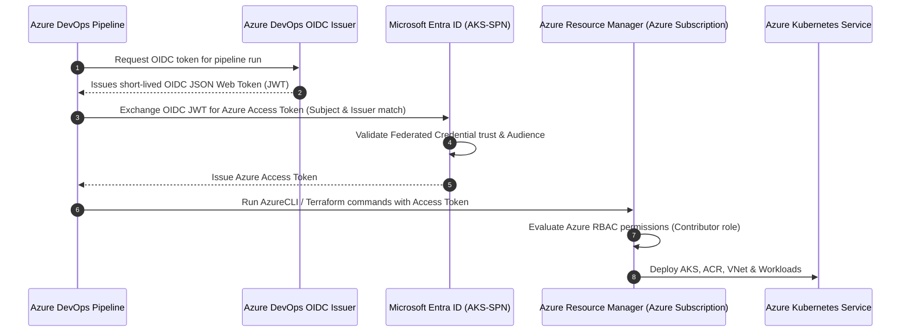

# 🚀 Azure DevOps to Azure Authentication using SPN + Workload Identity Federation (WIF)

[](https://azure.microsoft.com/)
[](https://dev.azure.com/)
[](https://www.terraform.io/)
[](https://azure.microsoft.com/en-us/products/kubernetes-service)
[](#-why-wif-secretless-authentication)

> **Complete Step-by-Step Practice & Production Guide for Azure DevOps, Microsoft Entra ID (Azure AD), Azure RBAC, Terraform CI/CD, and Azure Kubernetes Service (AKS).**

---

## 📑 Table of Contents
1. [🌟 Overview & Objectives](#-overview--objectives)
2. [🏗️ Architecture & High-Level Flow](#️-architecture--high-level-flow)
3. [🧠 Concept: WIF vs Traditional Client Secret](#-concept-wif-vs-traditional-client-secret)
4. [📋 Step-by-Step Implementation Guide](#-step-by-step-implementation-guide)
   - [Step 1: Create Microsoft Entra App Registration (`AKS-SPN`)](#step-1--create-microsoft-entra-app-registration-aks-spn)
   - [Step 2: Start Azure DevOps Service Connection Setup](#step-2--start-azure-devops-service-connection-setup)
   - [Step 3: Choose Subscription Scope & Manual (WIF) Path](#step-3--choose-subscription-scope--manual-wif-path)
   - [Step 4: Copy ADO Issuer & Subject Identifier](#step-4--copy-ado-issuer--subject-identifier)
   - [Step 5: Fill Subscription & Identity Details in ADO](#step-5--fill-subscription--identity-details-in-ado)
   - [Step 6: Configure Federated Credential in Microsoft Entra ID](#step-6--configure-federated-credential-in-microsoft-entra-id)
   - [Step 7: Grant Azure Subscription RBAC (Contributor Role)](#step-7--grant-azure-subscription-rbac-contributor-role)
   - [Step 8: Verify & Save Azure DevOps Service Connection](#step-8--verify--save-azure-devops-service-connection)
   - [Step 9: Pipeline Validation Test (`az account show`)](#step-9--pipeline-validation-test-az-account-show)
   - [Step 10: Complete Terraform CI/CD Pipeline](#step-10--complete-terraform-cicd-pipeline)
   - [Step 11: AKS Deployment & Kubernetes Management](#step-11--aks-deployment--kubernetes-management)
5. [🔄 Complete Flow At A Glance](#-complete-flow-at-a-glance)
6. [🛠️ Troubleshooting Guide](#️-troubleshooting-guide)
7. [🔒 Security Best Practices Checklist](#-security-best-practices-checklist)
8. [🎤 60-Second Interview Explanation & Q&A](#-60-second-interview-explanation--qa)
9. [📋 Quick Reference Table](#-quick-reference-table)

---

## 🌟 Overview & Objectives

In modern DevOps and Cloud Engineering, hardcoding client secrets or storing long-lived credentials inside CI/CD pipelines creates major security risks (credential leakage, expiration outages, secret rotation overhead).

**Workload Identity Federation (WIF)** enables Azure DevOps pipelines to authenticate securely to Microsoft Azure **without any client secrets or certificates**, using short-lived OpenID Connect (OIDC) federated tokens.

### What you will learn & build:
- Create a Microsoft Entra ID Application & Service Principal (`AKS-SPN`).
- Configure an **OIDC trust** between Azure DevOps and Microsoft Entra ID.
- Understand the difference between **Authentication (WIF)** and **Authorization (Azure RBAC)**.
- Securely execute **Terraform CI/CD pipelines** without long-lived credentials.
- Provision core Azure Infrastructure (Resource Group, VNet, Subnet, ACR, Log Analytics, AKS).
- Solve common production issues like `AuthorizationFailed` and Object ID / Client ID confusion.

---

## 🏗️ Architecture & High-Level Flow



---

## 🧠 Concept: WIF vs Traditional Client Secret

| Feature | Traditional Service Principal (Secret) | Workload Identity Federation (WIF) |
| :--- | :--- | :--- |
| **Credentials** | Long-lived Client Secret (Password/Cert) | **No secrets!** Short-lived OIDC token |
| **Risk of Leakage** | High (can be leaked in logs, Git, or config) | **Zero** (tokens are temporary & scoped) |
| **Rotation Maintenance**| High (requires manual/automated rotation before expiry) | **None** (managed automatically by platform) |
| **Trust Mechanism** | Secret string validation | **OpenID Connect (OIDC)** Cryptographic Trust |
| **Industry Standard** | Legacy / Non-recommended | **Modern Cloud Security Best Practice** |

> [!NOTE]
> **Golden Rule to Remember:**
> - **WIF = Authentication & Trust:** Confirms *who* Azure DevOps is.
> - **Azure RBAC = Authorization & Permissions:** Determines *what* that identity can do in your subscription.

---

## 📋 Step-by-Step Implementation Guide

### Step 1: Create Microsoft Entra App Registration (`AKS-SPN`)

1. Log in to the **[Azure Portal](https://portal.azure.com/)**.
2. Navigate to **Microsoft Entra ID** → **App registrations** → **+ New registration**.
3. Fill in the details:
   - **Name:** `AKS-SPN`
   - **Supported account types:** Accounts in this organizational directory only (Single tenant).
   - **Redirect URI:** Leave blank.
4. Click **Register**.
5. In the **Overview** blade, note down the following parameters:

| Field Name | Description | Where to use |
| :--- | :--- | :--- |
| **Application (client) ID** | Unique GUID of the application | Client ID in Azure DevOps |
| **Directory (tenant) ID** | Unique GUID of your Entra tenant | Tenant ID in Azure DevOps |
| **Object ID** | Object identifier in Entra ID | **Do NOT use as Client ID** (Internal only) |

> [!WARNING]
> Never confuse **Application (client) ID** with **Object ID**. Azure DevOps requires the **Application (client) ID**.

---

### Step 2: Start Azure DevOps Service Connection Setup

1. Open your **Azure DevOps Project**.
2. Go to **Project Settings** (gear icon at the bottom-left corner).
3. Under **Pipelines**, click **Service connections**.
4. Click **New service connection**.
5. Select **Azure Resource Manager** and click **Next**.

---

### Step 3: Choose Subscription Scope & Manual (WIF) Path

1. Choose **Workload Identity Federation (manual)** as the authentication method.
2. Select **Scope Level:** `Subscription`.
3. Provide a recognizable name for your connection:
   - **Service connection name:** `sc-aks-terraform`
   - **Description:** `Service connection for AKS Terraform provisioning using WIF`

> [!TIP]
> If the automatic subscription dropdown fails or loads indefinitely due to directory permissions, always choose the **Workload Identity Federation (manual)** method.

---

### Step 4: Copy ADO Issuer & Subject Identifier

On the manual WIF configuration screen, Azure DevOps displays two critical values:
- **Issuer:** e.g., `https://vstoken.dev.azure.com/<GUID>`
- **Subject identifier:** e.g., `sc://<Organization>/<Project>/<ConnectionName>`

> [!IMPORTANT]
> Copy both **Issuer** and **Subject identifier** exactly as shown. Keep this browser tab open while you switch back to the Azure Portal.

---

### Step 5: Fill Subscription & Identity Details in ADO

In the same Azure DevOps window, fill in your Azure details:
- **Subscription ID:** `<YOUR-AZURE-SUBSCRIPTION-ID>`
- **Subscription Name:** `<YOUR-AZURE-SUBSCRIPTION-NAME>`
- **Service Principal Client ID:** `<AKS-SPN Application (client) ID>`
- **Directory (Tenant) ID:** `<YOUR Directory (tenant) ID>`

*Do not click "Verify and save" yet—we must first establish trust in Azure in Step 6 & 7.*

---

### Step 6: Configure Federated Credential in Microsoft Entra ID

1. Switch back to the **Azure Portal**.
2. Go to **Microsoft Entra ID** → **App registrations** → Select **`AKS-SPN`**.
3. Under **Manage**, select **Certificates & secrets**.
4. Click on the **Federated credentials** tab.
5. Click **+ Add credential**.
6. Select scenario: **Other issuer**.
7. Enter the exact values:

| Field | Value |
| :--- | :--- |
| **Issuer** | *Paste Issuer copied from Azure DevOps (Step 4)* |
| **Subject identifier** | *Paste Subject identifier copied from Azure DevOps (Step 4)* |
| **Audience** | `api://AzureADTokenExchange` *(Default)* |
| **Name** | `ado-terraform-wif` |
| **Description** | `Federated trust for ADO pipeline to AKS-SPN` |

8. Click **Add**.

---

### Step 7: Grant Azure Subscription RBAC (Contributor Role)

Without Azure RBAC permissions, Azure DevOps will authenticate but fail with `AuthorizationFailed` when executing tasks.

1. In the Azure Portal, search for and open **Subscriptions**.
2. Click your target subscription.
3. Select **Access control (IAM)** from the left menu.
4. Click **+ Add** → **Add role assignment**.
5. Under the **Role** tab, search for and select **Contributor** (or custom least-privilege role). Click **Next**.
6. Under **Members**:
   - **Assign access to:** `User, group, or service principal`
   - Click **+ Select members**.
   - Search for **`AKS-SPN`**.
   - Select the service principal and click **Select**.
7. Click **Review + assign** to confirm.

---

### Step 8: Verify & Save Azure DevOps Service Connection

1. Return to your **Azure DevOps** tab where you set up the service connection.
2. Click **Verify and save**.
3. Azure DevOps will exchange a test federated token with Azure.
4. **Expected Result:**
   ```text
   Verification successful
   ```
5. Click **Save**.

---

### Step 9: Pipeline Validation Test (`az account show`)

Before deploying Terraform or Kubernetes, create a minimal pipeline to confirm that Azure DevOps successfully authenticates via Azure CLI.

Create `azure-pipelines-auth-test.yml`:

```yaml
trigger: none

pool:
  vmImage: 'ubuntu-latest'

steps:
  - task: AzureCLI@2
    displayName: "Verify Azure WIF Authentication"
    inputs:
      azureSubscription: 'sc-aks-terraform'
      scriptType: 'bash'
      scriptLocation: 'inlineScript'
      inlineScript: |
        echo "============================================="
        echo "🔐 Azure Authentication Verification"
        echo "============================================="
        az account show --output table
        echo "✅ WIF Token successfully exchanged with Azure!"
```

**Run this pipeline:** If `az account show` prints your Subscription ID and Tenant ID, secretless authentication is working properly!

---

### Step 10: Complete Terraform CI/CD Pipeline

Here is the production-grade Azure DevOps YAML pipeline for Terraform formatting, initialization, validation, planning, and deployment.

Create `azure-pipelines-terraform.yml`:

```yaml
trigger:
  branches:
    include:
      - main

variables:
  azureServiceConnection: 'sc-aks-terraform'
  terraformVersion: '1.8.0'
  workingDir: '$(System.DefaultWorkingDirectory)/terraform'

stages:
  - stage: ValidateAndPlan
    displayName: "Terraform Validate & Plan"
    jobs:
      - job: Plan
        pool:
          vmImage: 'ubuntu-latest'
        steps:
          - task: TerraformInstaller@1
            displayName: "Install Terraform"
            inputs:
              terraformVersion: '$(terraformVersion)'

          - task: AzureCLI@2
            displayName: "Terraform Init & Plan (WIF Authenticated)"
            inputs:
              azureSubscription: '$(azureServiceConnection)'
              addSpnToEnvironment: true
              scriptType: 'bash'
              scriptLocation: 'inlineScript'
              workingDirectory: '$(workingDir)'
              inlineScript: |
                set -e
                echo "1️⃣ Checking Terraform Code Format..."
                terraform fmt -check

                echo "2️⃣ Initializing Terraform Backend..."
                terraform init

                echo "3️⃣ Validating Terraform Configuration..."
                terraform validate

                echo "4️⃣ Generating Terraform Plan..."
                terraform plan -out=tfplan

          - publish: $(workingDir)/tfplan
            artifact: tfplan
            displayName: "Publish Plan Artifact"

  - stage: Apply
    displayName: "Terraform Apply (AKS Infrastructure)"
    dependsOn: ValidateAndPlan
    condition: and(succeeded(), eq(variables['Build.SourceBranch'], 'refs/heads/main'))
    jobs:
      - deployment: DeployAKS
        pool:
          vmImage: 'ubuntu-latest'
        environment: 'production'
        strategy:
          runOnce:
            deploy:
              steps:
                - checkout: self

                - task: TerraformInstaller@1
                  displayName: "Install Terraform"
                  inputs:
                    terraformVersion: '$(terraformVersion)'

                - download: current
                  artifact: tfplan
                  displayName: "Download Plan Artifact"

                - task: AzureCLI@2
                  displayName: "Apply Terraform Plan"
                  inputs:
                    azureSubscription: '$(azureServiceConnection)'
                    addSpnToEnvironment: true
                    scriptType: 'bash'
                    scriptLocation: 'inlineScript'
                    workingDirectory: '$(workingDir)'
                    inlineScript: |
                      set -e
                      terraform init
                      echo "🚀 Applying Terraform plan to Azure..."
                      terraform apply -auto-approve $(Pipeline.Workspace)/tfplan/tfplan
```

---

### Step 11: AKS Deployment & Kubernetes Management

The Terraform code provisions the complete cloud architecture:
```text
Azure Subscription
 └── Resource Group
      ├── Virtual Network (VNet) & Subnets
      ├── Azure Container Registry (ACR)
      ├── Azure Monitor & Log Analytics Workspace
      └── Azure Kubernetes Service (AKS Cluster)
```

Once the cluster is ready, interact with AKS using `kubectl`:

```bash
# 1. Get AKS credentials
az aks get-credentials --resource-group rg-aks-prod --name aks-cluster-prod --overwrite-existing

# 2. Verify cluster nodes
kubectl get nodes -o wide

# 3. Deploy Kubernetes applications
kubectl apply -f k8s/deployment.yaml
kubectl apply -f k8s/service.yaml
kubectl apply -f k8s/ingress.yaml

# 4. Check pod status
kubectl get pods -A
```

---

## 🔄 Complete Flow At A Glance

```text
1. Create App Registration (AKS-SPN) in Entra ID
      ↓
2. Note Application (Client) ID and Tenant ID
      ↓
3. Go to Azure DevOps → Project Settings → Service connections
      ↓
4. Select Azure Resource Manager → Workload Identity Federation (manual)
      ↓
5. Copy ADO-generated Issuer & Subject Identifier
      ↓
6. Azure Portal → App Registration (AKS-SPN) → Federated credentials
      ↓
7. Add Credential (Issuer, Subject, Audience: api://AzureADTokenExchange)
      ↓
8. Azure Portal → Subscriptions → Access control (IAM) → Add Contributor to AKS-SPN
      ↓
9. Return to Azure DevOps → Click "Verify and save" (Verification successful)
      ↓
10. Test via AzureCLI task (az account show)
      ↓
11. Execute Terraform CI/CD (fmt → init → validate → plan → apply)
      ↓
12. Provision AKS, ACR, VNet & Log Analytics
      ↓
13. Deploy workloads via kubectl / Helm
```

---

## 🛠️ Troubleshooting Guide

### ❌ 1. `AuthorizationFailed` (`Microsoft.Resources/subscriptions/read`)
* **Symptom:** During service connection verification or pipeline run, Azure reports:
  ```text
  The client 'xxxxxxxx-xxxx-xxxx-xxxx-xxxxxxxxxxxx' with object id '...' does not have
  authorization to perform action 'Microsoft.Resources/subscriptions/read' over scope '/subscriptions/...'.
  ```
* **Root Cause:** WIF authentication succeeded, but the service principal has no RBAC permissions on the subscription.
* **Fix:**
  1. Open Azure Portal → **Subscriptions** → Your Subscription → **Access control (IAM)**.
  2. Click **Add role assignment** → Select **Contributor** (or Reader/Custom role).
  3. Assign to member: **`AKS-SPN`**. Save and wait 1–2 minutes for RBAC replication.

---

### ❌ 2. Client ID vs Object ID Mismatch
* **Symptom:** Verification fails with *Invalid Client ID* or identity not found.
* **Root Cause:** Pasting the Entra ID **Object ID** instead of **Application (client) ID**.
* **Fix:**
  - Go to **Microsoft Entra ID** → **App registrations** → **`AKS-SPN`** → **Overview**.
  - Copy **Application (client) ID** (NOT Object ID).

---

### ❌ 3. Azure Subscription Does Not Appear in Dropdown
* **Symptom:** Automatic connection wizard says: *"No active Azure subscriptions were found."*
* **Root Cause:** User account in Azure DevOps does not have Entra ID directory administrator rights to auto-create service principals.
* **Fix:**
  - Switch to **Workload Identity Federation (manual)** mode.
  - Manually provide Subscription ID, Subscription Name, Client ID, and Tenant ID as described in Step 3–5.

---

### ❌ 4. Federated Token Validation Mismatch
* **Symptom:** Token exchange fails with *Audience or Subject mismatch*.
* **Root Cause:** Typo or leading/trailing space in Issuer or Subject identifier when pasting into Azure Federated Credentials.
* **Fix:**
  - Verify that Audience is set to `api://AzureADTokenExchange`.
  - Re-copy the exact **Issuer** and **Subject identifier** string from Azure DevOps into the Azure federated credential.

---

## 🔒 Security Best Practices Checklist

- [x] **Zero Secrets in Code:** Never commit passwords, client secrets, or `.tfvars` containing secrets to Git.
- [x] **Use WIF everywhere:** Use Workload Identity Federation for all Azure DevOps service connections.
- [x] **Least Privilege Access:** Scope RBAC to a Resource Group rather than the entire Subscription whenever feasible.
- [x] **Remote State Locking:** Store Terraform state in an encrypted Azure Storage Account with blob lease locking.
- [x] **Pipeline Environment Approvals:** Enforce manual approval gates on production deployment stages.
- [x] **Restrict Service Connection Usage:** Limit pipeline permissions on the service connection to authorized repositories and branches.

---

## 🎤 60-Second Interview Explanation & Q&A

### 🎙️ The 60-Second Elevator Pitch
> *"In my project, I configured secure, secretless CI/CD authentication between Azure DevOps and Azure using **Workload Identity Federation (WIF)**.
>
> First, I created a Microsoft Entra ID App Registration called **AKS-SPN**. In Azure DevOps, I created an Azure Resource Manager Service Connection using the manual WIF flow, which generated an **Issuer** and a **Subject identifier**.
>
> I configured these as a **Federated Credential** on `AKS-SPN` with the standard `api://AzureADTokenExchange` audience. Then, I assigned the **Contributor** role to `AKS-SPN` at the Azure subscription scope for authorization.
>
> To ensure reliability, I verified authentication using an `AzureCLI@2` task with `az account show`. Once validated, the Terraform pipeline executes `fmt`, `init`, `validate`, `plan`, and `apply` using the same secretless identity to deploy our AKS cluster, ACR, and networking infrastructure without managing expiring passwords or secrets."*

---

### ❓ Key Interview Questions & Answers

**Q1: What is the core difference between WIF and Client Secret authentication?**  
*Answer:* A Client Secret is a static, long-lived password that can be leaked and requires rotation. WIF uses OpenID Connect (OIDC) to exchange short-lived tokens on the fly based on a cryptographic trust between Azure DevOps and Microsoft Entra ID. No credentials are ever stored.

**Q2: If service connection verification fails with `AuthorizationFailed`, where is the issue?**  
*Answer:* The issue is in **Azure RBAC**, not in WIF authentication. WIF successfully verified the identity, but that identity does not have permission (`Contributor` or `Reader`) on the subscription scope in **Access control (IAM)**.

**Q3: Can we scope WIF to a specific Git branch or environment?**  
*Answer:* Yes! The **Subject identifier** generated by Azure DevOps contains repository and environment/branch information. You can restrict the federated credential in Azure so only runs from `refs/heads/main` or a specific release environment are allowed to exchange tokens.

---

## 📋 Quick Reference Table

| Component | Role / Purpose | Key Configuration |
| :--- | :--- | :--- |
| **`AKS-SPN`** | Microsoft Entra App & Service Principal | Identity representation in Azure |
| **Application (Client) ID** | Unique Application Identifier | Used in ADO Service Connection |
| **Directory (Tenant) ID** | Azure AD Tenant Identifier | Used in ADO Service Connection |
| **Issuer & Subject** | OIDC Identity Coordinates | Generated by ADO, configured in Entra ID |
| **Audience** | Token intended recipient | `api://AzureADTokenExchange` |
| **Azure RBAC (IAM)** | Permission assignment | `Contributor` role on Subscription |
| **`AzureCLI@2`** | Pipeline authentication verification | Runs `az account show` |
| **Terraform AzureRM** | Infrastructure as Code orchestration | Provisions AKS, ACR, VNet, Monitoring |
| **AKS** | Managed Kubernetes Cluster | Hosts containerized microservices |

---

<p align="center">
  <b>Built with ❤️ for DevOps Engineers & Cloud Architects</b><br>
  <i>Feel free to star ⭐ this repository if it helped your cloud journey!</i>
</p>
